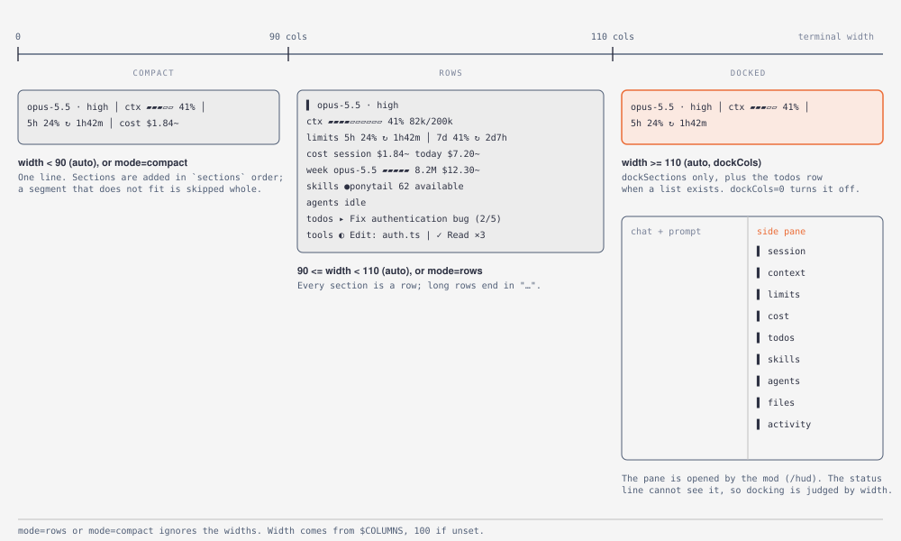

# system32

A heads-up display for Claude Code, drawn in the status line: context, rate limits, cost, skills, sub-agents, todos and tool activity, always visible below your prompt. A mod adds a docked side pane, a working line and a job-complete line.

The status line is one zero-dependency Node file. No network, no telemetry. (The plugin id, paths and config file are still named `session-hud`.)

```
▌ opus-5.5 · high
ctx ▰▰▰▰▱▱▱▱▱▱ 41%  82k/200k  118k left
5h ▰▰▱▱▱▱▱▱▱▱ 24% ↻ 1h42m (16:30 PST)   │   7d ▰▰▰▱▱▱▱▱▱▱ 41% ↻ 2d7h (Tue 12:12 PST)
cost   session $1.84~  today $7.20~  week $31.40~   ~ estimate at list price, not a bill
week   opus-5.5 ▰▰▰▰▰ 8.2M $12.30~  ·  sonnet-5.5 ▰▰ 2.1M $1.10~   ▂▃▅▇▅▃▆
skills ●ponytail  ●nextjs    62 available
agents 2 running  ◐ Explore "map auth" 0:42  ◐ Plan "design" 1:10  ✓3
todos  ▸ Fix authentication bug (2/5)
tools  ◐ Edit: auth.ts | ✓ Read ×3 | ✓ Grep ×2
```

## Install

```
claude plugin marketplace add cmxau/system32-hud
claude plugin install session-hud@<marketplace>
```

Then, inside Claude Code, say "set up session-hud" (runs the `setup` skill), or run `node <plugin>/src/hud.js install [--user]`. Plugins can't ship a `statusLine`, so `install` edits your settings with a backup; `uninstall` restores the previous one. Details, snapshot behaviour and local testing: [docs/installation.md](docs/installation.md).

## What you get

- **Status line rows:** model, context, 5h/7d limits, cost (session, today, week), per-model weekly usage, skills, agents, todos, tools; optional project and uptime. Collapses to one line when narrow.
- **Side pane** (`/hud`): session, context breakdown, limits, cost, todos, skills, agents, most-edited files, activity. On wide terminals the bottom line trims to just model, context and limits.
- **Working line**, **job-complete line** and **toasts** for long turns and full context.

All rows, pane blocks and layout modes: [docs/features.md](docs/features.md).



## Configure

Settings live in `~/.claude/session-hud.json`; every key is optional.

```json
{ "theme": "monokai", "mode": "auto", "dockCols": 110, "sections": ["model", "ctx", "limits", "cost", "week", "skills", "agents", "todos", "tools"],
  "skills": { "pinned": ["ponytail"], "detect": true }, "bar": { "style": "blocks", "width": 10 } }
```

```
node src/hud.js config preview mode=compact   # render the last real input with the change, save nothing
node src/hud.js config set bar.width=8        # preview, back up to session-hud.json.bak, save
node src/hud.js config undo                   # restore the backup (last change only)
node src/hud.js replay                        # re-render the last status-line input
node src/hud.js report                        # write a scrubbed bug report locally
```

**Themes:** `default`, `monokai`, `abyss`, `solarized`, `matrix` (green on black), `dracula`, `nord`, `gruvbox`, `tokyo-night`, `synthwave`, `rose-pine`. List them with `node src/hud.js config themes`, switch with `config set theme=nord`.

`SESSION_HUD_DISABLE=1` turns the HUD off for a session. Every key, default and env var: [docs/configuration.md](docs/configuration.md).

## Privacy and security

No network calls. It reads the status-line JSON, hook payloads, your transcripts (for cost) and `CLAUDE.md` (for pinned skills), and writes only under `~/.claude/session-hud/` (private, 0700/0600), its config file and, on install, your settings file. Bash commands are never recorded; the optional raw debug log is off unless `SESSION_HUD_DEBUG=1`. Cost figures are estimates at list price, not a bill. Threat model and hardening: [docs/security.md](docs/security.md).

## Docs

| Page | Covers |
|---|---|
| [installation](docs/installation.md) | install, uninstall, snapshot behaviour, local testing |
| [features](docs/features.md) | every row and pane block, layout modes |
| [configuration](docs/configuration.md) | every key and default, commands, environment |
| [data sources](docs/data-sources.md) | where each number comes from, and its caveats |
| [architecture](docs/architecture.md) | components, files, hooks, data flow, cost derivation |
| [security](docs/security.md) | threat model and hardening |
| [troubleshooting](docs/troubleshooting.md) | blank HUD, `limits —`, stale numbers, pane, refusals |

Contributing: [CONTRIBUTING.md](CONTRIBUTING.md). Tests: `node --test tests/` and `claude plugin validate .`. License: MIT.
