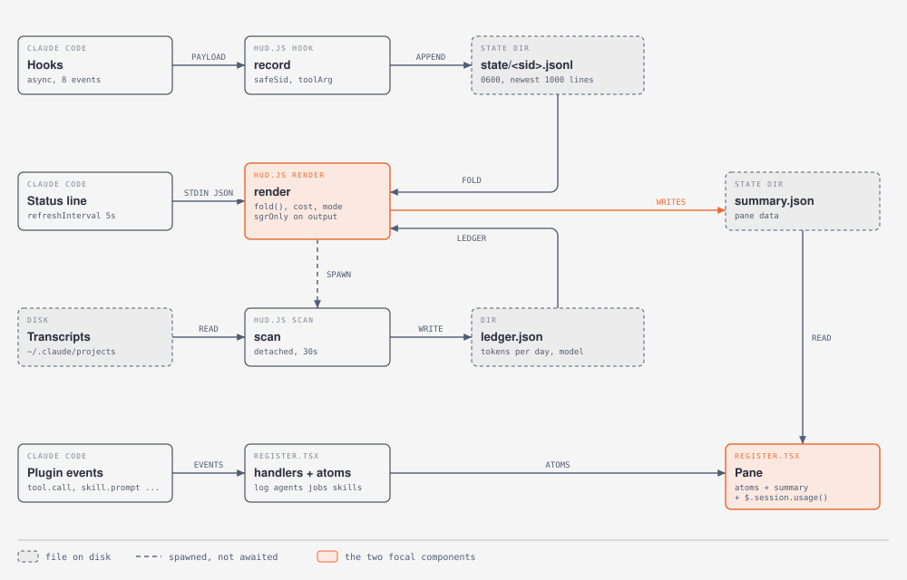
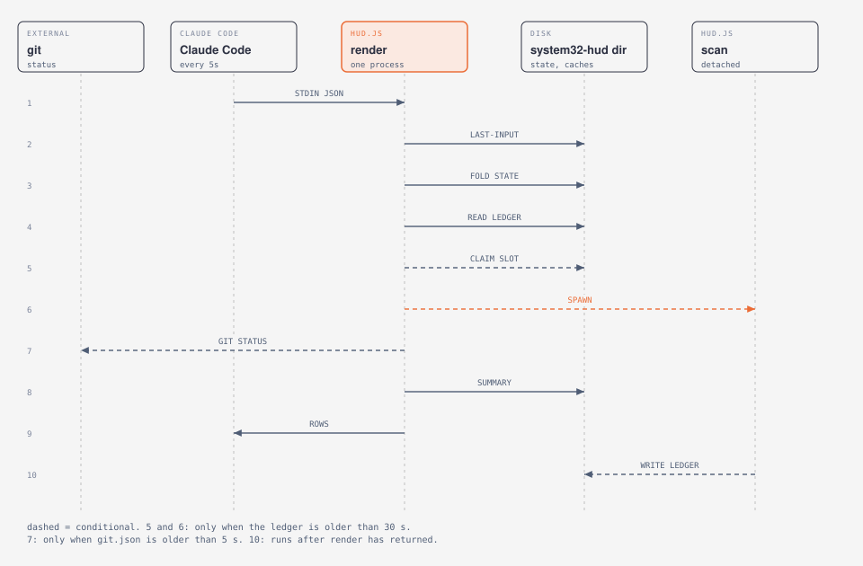
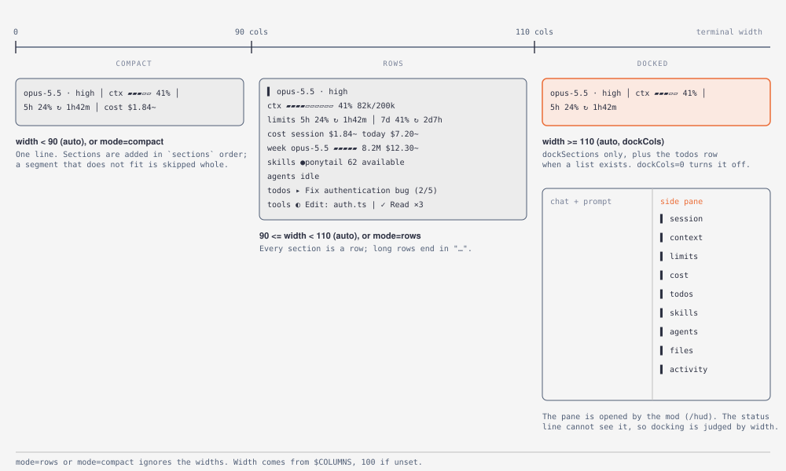

# Architecture

session-hud has two halves that never call each other: a Node script (`src/hud.js`) that renders the status line and records hook events, and a mod (`hooks/register.tsx`) that draws the pane, the working line and the job-complete line. They share data through files under `~/.claude/session-hud/`.



## Components

| Component | Runs as | Does |
|---|---|---|
| `hud.js` (render, default mode) | the statusLine command, one process per refresh | reads status-line JSON on stdin, folds the session's event log, reads the ledger, prints rows, writes `last-input.json` and `summary.json` |
| `hud.js hook` | async command hook, one process per event | turns a hook payload into one small event line appended to `state/<sid>.jsonl` |
| `hud.js scan` | detached child spawned by render | incrementally reads transcripts and updates `ledger.json` |
| `hud.js install/uninstall/config/replay/report` | CLI | settings and config edits, read-only re-render, scrubbed report |
| `hooks/register.tsx` | mod loaded by Claude Code | atoms from plugin events, the `Pane`, `Spinner` and `TurnDuration` renderers, the `/hud` command, toasts |
| `hooks/hooks.json` | plugin manifest | registers the hooks and the mod (`modules: ["./register.tsx"]`) |

## Files on disk

All under `~/.claude/session-hud/` (dir 0700, files 0600) unless noted.

| File | Writer | Reader |
|---|---|---|
| `state/<sid>.jsonl` | `hud.js hook` | render (`fold()`) |
| `state/<sid>.summary.json` | render | the pane (`register.tsx`) |
| `ledger.json` | `scan`; render writes only the `scannedAt` claim | render |
| `last-input.json` | render (every refresh) | `replay`, `report`, `config preview` |
| `git.json`, `skills-count.json` | render (5s and 60s caches) | render |
| `prev-statusline.json` | `install` | `uninstall` |
| `hud.js` | `install` (not with `--link`) | the statusLine command |
| `report.md` | `report` | you |
| `debug.jsonl` | `hud.js hook`, only with `SESSION_HUD_DEBUG=1` | you |
| `~/.claude/session-hud.json`, `.bak` | you, `config set` | render (config), `config` |
| `<settings>`, `<settings>.hud-bak` | `install`, `uninstall` | Claude Code |

Reads outside this directory: `~/.claude/projects/**/*.jsonl` (transcripts), `~/.claude/skills`, `<cwd>/.claude/skills`, `~/.claude/plugins/installed_plugins.json` and each plugin's `skills/` (skills-available count), and up to 64 KB of `~/.claude/CLAUDE.md`, `<cwd>/CLAUDE.md`, `<cwd>/.claude/CLAUDE.md` (pinned-skill detection).

## Hook events and why

All hooks are `async` with a 10 s timeout, so they never block Claude Code.

| Hook (matcher) | Event line | Used for |
|---|---|---|
| `SessionStart` | `start` (also prunes state files untouched for 7 days) | resets the fold: agents, skills, todos, tools, uptime |
| `PreToolUse` `Skill` | `skill` | skills row |
| `PreToolUse` `TodoWrite` | `todos` (up to 100 items) | todos row |
| `PreToolUse` `Agent\|Task` | `call` (description, type, model) | queued agent, later joined to its start |
| `PreToolUse` other tools | `tstart` (id, name, short argument) | running tools |
| `PostToolUse` other tools | `tend` | completed counts |
| `PostToolUse` `Agent\|Task` | `adone` (resolved model) | agent model |
| `PostToolUseFailure` `Agent\|Task` | `afail` | agent failed |
| `SubagentStart` / `SubagentStop` | `astart` / `astop` | running/done; no `tool_use_id` on start, so it is matched to the oldest queued call of the same type |
| `UserPromptExpansion` | `skill` (typed) | slash-invoked skills |
| `PostModelSwitch` | `model` | the `⇢` marker when another model answers |

Failed non-agent tools produce no event, which is why a denied or interrupted tool is dropped after 10 minutes. The event file is bounded: over 2 MB, the newest 1000 lines are kept (always including the session's last `start`) and swapped in atomically.

## The pane's data paths

The pane runs inside Claude Code's mod runtime, with no access to transcripts or hook payloads.

| Pane data | Path |
|---|---|
| context, limits, session cost, model, turns, uptime, repo | live: `$.session.usage()`, `$.session.model()`, `$.session.turns()`, `$.session.repo()` |
| activity, files, agents, jobs, skills invoked | atoms filled from the mod's own events: `tool.call`, `agent.spawn`, `agent.report`, `turn.complete`, `skill.prompt`, `prompt.submit` |
| today/week cost, per-model week, todos, skills available, pinned skills | `state/<sid>.summary.json`, read with `$.fs.read` and shape-checked by `parseSummary` |
| redraw | `$.clock.every(5000)` and `session.measure` bump a `tick` atom |

**Why the summary file exists:** week totals need a transcript scan, and todos and pinned skills come from hook events and `CLAUDE.md`; the pane can read none of them. The renderer already has all of it on every refresh, so it writes the result next to the event log. The cost is up to one refresh of lag, and the pane shows nothing for those blocks until the status line has run once. The pane's skills list (`skill.prompt`) and the status line's (hooks) are tracked separately and can differ.

The mod's own events also drive the working line (phase from the running tool, elapsed since `prompt.submit`), the job-complete line (counts per turn from `turn.complete`) and the toasts (turn over 120 s; context at 80% or more, re-armed below 60%).

## One refresh



Render never scans inline. When `ledger.json` is missing or `scannedAt` is older than 30 s, render first writes a new `scannedAt` (claiming the slot so concurrent renders do not each spawn one) and then spawns `hud.js scan` detached with stdio ignored. The current render uses the ledger as it was, so numbers lag a scan behind; a missing ledger shows `scanning transcripts…`. `git status` runs only when `project` is in `sections` or `dockSections`, is cached 5 s, and times out at 800 ms. `replay`, `report` and `config preview` skip every one of those writes and the scan.

## Mode selection



```
docked = mode == auto && dockCols != 0 && cols >= dockCols
mode   = docked ? compact(dockSections) : auto ? (cols >= 90 ? rows : compact) : cfg.mode
```

`cols` is `$COLUMNS`, or 100 if unset. Rows mode prints one row per section in `sections` order, each cut to the width with `…`. Compact mode joins one segment per section with ` │ ` in order and skips any segment that would overflow, so earlier sections win. A section with no compact segment (for example `tools` while nothing runs) is skipped. Docked adds the todos row when a todo list exists. Docking is a width guess: `dockCols` affects only the status line, and the mod simply opens the pane.

Every output line passes through `sgrOnly`, which strips everything except color escapes.

## How cost is derived

- **Session:** `cost.total_cost_usd` from the status-line JSON. Claude Code's number, not recomputed.
- **Today, week, per-model week:** `scan` reads assistant lines from transcripts modified in the last 8 days and sums usage into `days[YYYY-MM-DD][model] = [input, output, cacheRead, cacheWrite5m, cacheWrite1h]` (local days; 14 days kept). Each file's byte offset is stored, so a pass reads only new bytes (at most 32 MiB per file per pass). Only complete lines are consumed.
- **Duplicates:** one API message is written once per content block with the same id. The scan keeps the last message per file and replaces its tokens when the next line has the same id.
- **Dollars:** the model id is matched against the `PRICES` regex table ($/MTok input, output, cache read). Cache writes are 1.25x input (5 minute) and 2x input (1 hour).
- **Week** is the 7 local days ending today; **today** is the last of them.

Caveats: the transcript format is undocumented and unknown lines are skipped; cache-write rates and some older cache-read rates are assumed; a model with no price shows tokens but no dollars and is left out of today and week totals, so those totals can undercount; only this device's `~/.claude/projects` is read; transcripts older than 8 days are never read; the dedupe only catches consecutive repeats; transcript symlinks and symlinked directories are not followed, and the walk stops at depth 6 and 5000 files.

## Concurrency

- Render, hooks and the scan run as separate processes with no locks.
- Every JSON file other than the event log is written to `<file>.<pid>` (exclusive create) and renamed, so readers see the old or the new file, never a partial one. The event log is append-only.
- The ledger claim is a best-effort guard: two renders in the same instant can both spawn a scan, which is wasteful but harmless because the scan is incremental and writes atomically. The last writer wins, so a scan's final write can overwrite a newer claim.
- The scan is detached and unawaited, so a slow scan never delays a refresh.
- Async hooks may finish out of order, so event order in `state/<sid>.jsonl` is arrival order, not strict hook order.
