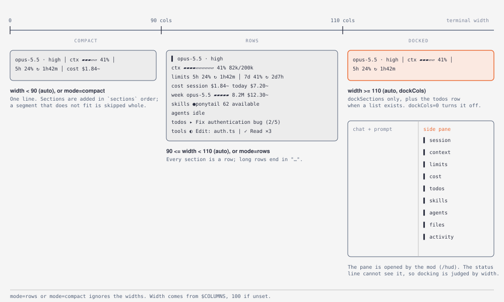

# Features

## Status line rows

| Row | Shows |
|---|---|
| model | model, effort, `⚡` fast mode, `[Bedrock]` / `[Vertex]` / `[host]` when not on Anthropic's API, `⇢ x` if a different model than selected is answering |
| ctx | context used, tokens left; green, then yellow, then red as it fills |
| limits | 5h and 7d subscription windows with a reset countdown and clock time; `spend N%` when Claude Code reports a spend limit |
| cost | session, today and rolling-week spend (estimates) |
| week | per-model tokens and cost for 7 days, plus a daily sparkline |
| skills | skills invoked this session (`●`), pinned always-on ones (`○`), and how many are available |
| agents | running sub-agents with type, task, model and elapsed time; done and failed counts |
| todos | the active `TodoWrite` item and progress |
| tools | running tool calls and completed counts per tool |
| project *(optional)* | name, path, git branch, modified and untracked counts |
| uptime *(optional)* | session wall-clock time |

Below 90 columns, `auto` mode collapses to one line and drops the segments that don't fit. At `dockCols` (110) or wider it trims to one line of `dockSections` (default model, ctx, limits), plus the todo row when a list exists, because the pane carries the detail. The status line can't see whether the pane is open, so it goes by width: if you close the pane, set `"dockCols": 0` or `mode` to `rows`. Width is read from `$COLUMNS` (100 if unset).

## Side pane and extras

Loaded with the plugin (`hooks/register.tsx`). The mod opens the pane at session start and `/hud` reopens it.

| Block | Shows |
|---|---|
| session | model, turns, uptime, repo name |
| context | bar and tokens left, plus the five biggest contributors (system prompt, tools, memory, messages) |
| limits | 5h and 7d with reset countdowns |
| cost | session, today and week spend, and per-model weekly tokens and dollars (estimates) |
| todos | the active item and progress |
| skills | skills invoked (`●`), pinned always-on ones (`○`), and how many are available |
| agents | running and recent sub-agents |
| files | most-edited files |
| activity | call count, failures and the latest tool calls; last, and hidden when the terminal is short |

Live numbers come from `$.session.usage()`, so they match the status line. Week, skills-available, pinned skills and todos come from `~/.claude/session-hud/state/<session>.summary.json`, which the status line rewrites on each refresh (the pane has no transcript or hook access). The pane redraws every 5s.

Also: a **working line** under the spinner (a sliding bar plus `editing · 4 ops · 42s`), a **job-complete line** replacing "Baked for 3s" (`✓ 2m14s · 6 edits · 3 cmds · 0 errors`), and **toasts** for turns over 2 minutes and context at 80% or more.

How the pieces fit: [docs/architecture.md](architecture.md).
